# 企业级大模型服务的三层契约架构设计

**——以网络故障智能处置系统 NOC-Pilot 为验证**

| 项 | 内容 |
| --- | --- |
| 文档类型 | 架构设计论文 |
| 设计对象 | 可嵌入既有 Java 业务系统的企业级大模型服务 |
| 验证系统 | NOC-Pilot（网络故障智能处置，数据已脱敏） |
| 读者 | 负责把大模型接入生产的后端架构师与核心开发 |
| 版本 | v2.0 |
| 日期 | 2026-11-05（Asia/Shanghai） |

**关键词**：企业级大模型服务；三层契约；应用网关；检索数据产品；Agent 事务；推理 SLA；混合路由；网络运维

---

## 摘要

企业把大模型接进已有业务系统时，失败通常不是“模型不够强”，而是服务没有边界。一次网络故障处置里，过期手册被当成现行规范、模型编造的命令参数穿过了可写接口、交互问答和长文本总结抢同一张 GPU，三条问题同时出现，系统对外却只表现为“AI 不靠谱”。

本文设计一套**三层契约架构**，用来把大模型服务嵌进以 Java 为核心的企业系统，并保持生产行为可校验、可降级、可计量。三层分别是：

1. **应用契约层**。对上提供稳定的领域接口、权限、超时、审计和闸门，对下只接收结构化结果。
2. **编排契约层**。把检索做成带版本的数据产品，把多步推理做成有预算、有补偿的事务。
3. **推理契约层**。把 Prefill、Decode、显存、并行和通信，收敛成应用层可消费的服务等级协议。

五条不变量贯穿三层：请求可追踪、输出可校验、失败可降级、成本可计量、数据可隔离。模型、提示词和 GPU 都可以替换，不变量保持不动。

本文以网络故障智能处置系统 NOC-Pilot 作为设计的实例化。预生产灰度六周的脱敏结果显示：人均处理停留时间由 11.4 分钟降到 6.9 分钟，一线可独立关闭比例由 44% 升到 63%，无引用回答率由 18% 降到 1.1%，错误处置草案全部停在审批闸门之内。综合成本低于全量使用最大私有模型约 34%。

---

## 目录

1. [引言](#1-引言)：设计对象、事故断点、目标与全文地图
2. [需求模型](#2-需求模型)：由断点得到 R1–R10，作为后文验收编号
3. [总体架构](#3-总体架构)：三层、五条不变量、十二步生命周期
4. [应用契约层设计](#4-应用契约层设计)：对象、网关、路由、闸门
5. [编排契约层设计](#5-编排契约层设计)：证据数据产品与有界工具事务
6. [推理契约层设计](#6-推理契约层设计)：预填充/解码、显存、并行与 SLA
7. [控制面设计](#7-控制面设计)：降级、成本、安全、三条时间线
8. [设计验证：NOC-Pilot](#8-设计验证noc-pilot)：按十二步走单，按十条需求验收
9. [实施路径](#9-实施路径)：分阶段出口条件与分工
10. [讨论与局限](#10-讨论与局限)：适用条件与不覆盖的问题
11. [结论](#11-结论)

阅读顺序就是章节顺序。第 3 章的十二步是后文的主线，第 8 章按同一步骤回放一张故障单，用来检查设计是否闭合。

---

## 1 引言

### 1.1 本文要设计什么

本文设计的不是一个聊天机器人，也不是一个模型。设计对象是一套**企业级大模型服务架构**：它跑在现有工单、网管、权限和审计体系旁边，对外提供“带证据的处置建议”，对内把检索、工具调用和 GPU 推理组织成可运营的服务。

架构的名字叫**三层契约**。契约在这里是一个工程定义：每一层向上一层公开一组可检查的承诺，包括输入输出结构、时限、失败语义、预算和审计字段。上一层只依赖这些承诺，不依赖提示词原文、向量库品牌或 GPU 拓扑。

读完本文，读者应能回答四件事：

1. 这套服务由哪三层组成，每一层负责什么、不负责什么。
2. 一次业务请求怎样穿过三层，在哪一步被校验、被拒绝或被降级。
3. 检索质量、工具副作用、GPU 容量，分别用什么指标约束。
4. 一个网络运维系统怎样按这套架构落地，以及落地之后用什么数字验收。

### 1.2 背景

大模型已经能阅读告警、手册和日志，并写出像工程师的分析。对拥有大量 Java 业务系统的企业，接入方式往往从一次 HTTP 调用开始：Controller 里拼一段提示词，把模型返回的文本展示在页面上。演示阶段这条路径足够快。进入值班、变更和审计之后，它立刻不够。

原因在于业务系统与模型服务遵守两套不同的运行规则。

| | 既有业务系统 | 大模型推理 |
| --- | --- | --- |
| 输入输出 | 模式固定，可做契约测试 | 文本分布，需要解析后才成为对象 |
| 相同输入 | 得到相同结果 | 得到同一分布上的一次采样 |
| 失败形态 | 超时、错误码、回滚 | 胡写、漏引用、工具参数不存在 |
| 容量单位 | QPS、连接数、CPU | Token、KV Cache、GPU 秒 |
| 延迟形态 | 毫秒级 RPC | 首 token 延迟加逐 token 生成 |

把第二列直接塞进第一列的接口里，调用方以为自己在做远程过程调用，服务方实际在做一次采样。两边对“成功”的定义不一致，测试、限流、计费和追责都会落空。

### 1.3 一次事故暴露的三个断点

用一次真实形态的值班事故把问题钉住。凌晨，骨干网一条 BGP 会话连续抖动。网管完成了告警收敛和开单。新上线的助手给出根因说明，并建议对邻居执行 `clear ip bgp`。事后复盘看到三个彼此独立的断点。

**断点 A，知识。** 检索把 2019 年已作废的操作排在 2024 年现行规范前面。模型忠实引用了过期文档，于是错误看起来有出处。

**断点 B，行动。** 助手把告警中的 AS 号填进邻居地址字段，调用了预演接口。该接口与可写适配器没有分开，参数穿过了本应存在的审批。

**断点 C，算力。** 同一分钟里，值班追问、大屏长文总结和几十条低优先级摘要进入同一张 GPU。长输入的预填充打散了逐 token 解码的批次，首 token 时间从 800 毫秒升到 12 秒。值班人员判定助手不可用，改回手工处置。

三个断点分别位于知识、行动和算力。对外症状却只有一个：“这个 AI 不能上生产”。后续章节的架构，就是按这三个断点各设一层契约。

### 1.4 设计目标与边界

**目标。**

| 编号 | 目标 | 验收时看什么 |
| --- | --- | --- |
| G1 | 业务只消费结构化建议，不消费自由文本 | 接口返回对象，字段可做契约测试 |
| G2 | 模型不直接改变生产状态 | 写操作必须先草案、后审批 |
| G3 | 建议能够指回证据，过期证据不能被当成现行规范 | 引用覆盖率、过期引用率 |
| G4 | 推理容量可规划，交互与批处理互不拖垮 | TTFT、TPOT、队列隔离 |
| G5 | 任一请求可按租户记账、按链路追责 | trace、token、工具回执在同一条审计里 |

**边界。** 本文不设计预训练、不设计微调算法、不设计 GPU 算子。推理层只设计到“服务等级协议和调度策略”这一深度，保证后端架构师能做容量与路由决策。领域对象以网络运维为例，同一架构可迁到客服、研运、财务审核等“建议与草案”类场景，迁的是契约，不是提示词。

### 1.5 贡献

1. 给出三层契约的职责划分、层间接口和不变量，使大模型服务能够按层替换。
2. 给出检索数据产品与工具事务的设计，把知识质量和写操作边界变成可测试条款。
3. 给出推理层到应用层的 SLA 字段，把 Prefill、Decode、并行和显存换算成容量模型。
4. 用 NOC-Pilot 把上述设计跑通，并给出与需求一一对应的验收结果。

### 1.6 文章组织

全文按“需求 → 总图 → 分层设计 → 控制面 → 实例验证 → 实施”推进。后一章使用前一章定义的对象，不另起一套概念。

| 章 | 回答的问题 | 产出 |
| --- | --- | --- |
| 2 | 这套服务必须满足哪些需求 | 需求表 R1–R10 |
| 3 | 总体长什么样，一次请求怎么走 | 三层总图与生命周期 |
| 4 | 应用层如何把模型关进接口 | 网关、对象模型、闸门 |
| 5 | 编排层如何约束知识和行动 | 检索产品、Agent 事务 |
| 6 | 推理层如何把物理事实变成 SLA | 容量模型与并行策略 |
| 7 | 三层怎样被统一运营 | 稳定、成本、安全、观测 |
| 8 | 设计是否经得起一个系统检验 | NOC-Pilot 与验收 |
| 9 | 团队怎样分期把它做出来 | 阶段出口条件 |
| 10 | 这套设计用在哪里会失效 | 边界与局限 |

---

## 2 需求模型

> **本章任务**：把第 1 章的事故拆成一组可设计、可验收的需求。后文每一条设计都能指回这里的编号。

### 2.1 服务在系统中的位置

大模型服务不替换工单、CMDB、网管和变更系统。它位于它们之间，消费这些系统的只读数据，生产两类结果：

- **假设**：对当前故障的解释，必须带证据编号。
- **草案**：一组尚未执行的操作建议，必须带风险等级。

生产状态仍然只由原系统的状态机修改。助手是工单上的一块面板，加上一个“提交草案”按钮。按钮通向原变更系统的审批流，不通向模型。

### 2.2 从三个断点归纳需求

断点 A 要求知识带时间和权限，并且答案必须能指回条目。由此得到 R3、R4。

断点 B 要求模型输出先变成对象，写意图与写执行分开。由此得到 R1、R2。

断点 C 要求不同流量进入不同推理队列，并且慢请求有退路。由此得到 R5、R6、R7。

值班、审计和财务还会追加三条与单次回答质量无关、但没有就无法上生产的需求：R8、R9、R10。

| 编号 | 需求 | 所属断点 | 主要承接层 |
| --- | --- | --- | --- |
| R1 | 模型输出可解析为领域对象，解析失败视为调用失败 | B | 应用层 |
| R2 | 任何写生产的动作都先生成草案，审批通过后才由原系统执行 | B | 应用层 + 编排层 |
| R3 | 检索条目带生效期、作废期、适用型号和密级 | A | 编排层 |
| R4 | 没有合格证据时拒答，禁止补写未出现的对象名 | A | 编排层 |
| R5 | 单次推理有步数、工具次数、时限和 token 预算 | C | 编排层 + 推理层 |
| R6 | 模型平面不可用时，仍能走规则或人工退路 | C | 应用层 |
| R7 | 交互问答与长文本批处理使用隔离的推理容量 | C | 推理层 |
| R8 | 每次调用的 token、GPU 时间和工具次数可按租户汇总 | 运营 | 控制面 |
| R9 | 从 HTTP 到检索命中、工具回执、GPU 调度使用同一 trace | 运营 | 控制面 |
| R10 | 高于指定密级的原文不得进入公有云模型 | 安全 | 应用层 |

这十条是后文的验收清单。第 8 章会逐条给出 NOC-Pilot 的实现位置和结果。

### 2.3 双轨分工

同一张故障单上，有些步骤必须确定，有些步骤适合采样。

确定步骤包括：告警收敛、设备与链路查询、权限判断、变更窗口判断、审批、状态流转、计费。这些步骤相同输入必须得到相同输出，失败必须可回放。

采样步骤包括：把多源证据综合成根因假设、把假设写成值班能读的段落、给出多种处置草案的表述。这些步骤允许波动，但波动必须落在证据集合之内。

两条轨道在校验点会合。会合之后，对外发布的只有通过校验的对象。采样轨道没有数据库写连接，也没有设备写连接。

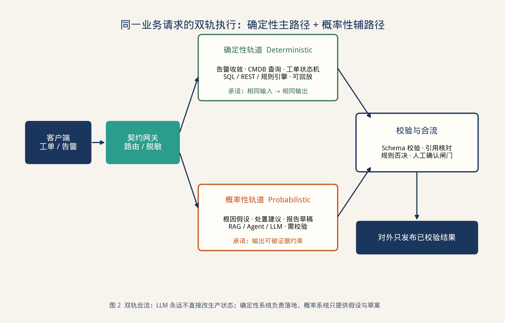

> **图 2** 确定轨道维护状态，采样轨道产出假设与草案，合流之后才对外发布。

### 2.4 成功标准怎么写才可测试

“回答专业”不能作为验收语句。每条需求对应一个可计算指标或一个可演示的故障注入。

| 需求 | 可测试标准（起点） |
| --- | --- |
| R1 | 契约测试 100% 通过；无法解析的响应计为错误，不展示给用户 |
| R2 | 故障注入“模型直接调用写接口”时期望被拒；生产变更单数量不因助手增加非法单 |
| R3 | 抽查索引，生效期、密级、型号字段缺失率为 0 |
| R4 | 黄金集上无证据样本的拒答率 ≥ 0.95；引用覆盖率 ≥ 0.90 |
| R5 | 人为构造超步数任务，系统在预算处停止并留下原因码 |
| R6 | 切断主模型后，简单告警仍由规则引擎给出已知处置，复杂单升级人工 |
| R7 | 注入长文本批任务时，交互 TTFT P95 恶化不超过约定比例 |
| R8 | 按租户导出日账单，与网关日志条数一致 |
| R9 | 随机抽取慢请求，10 分钟内能指出慢在检索、工具、排队还是解码 |
| R10 | 携带高密级标签的请求在路由单测中不会选择公有云 |

指标的具体阈值可以随业务调整，编号不能省。没有编号的优化讨论，无法判断改动落在哪一层。

> **本章要点**：服务的职责是产出“有证据的假设”和“待审批的草案”。十条需求 R1–R10 来自知识、行动、算力三类断点，并补上记账、追踪和密级。下一章用三层把这些需求装进一张总图。

---

## 3 总体架构

> **本章任务**：给出三层的职责、层间接口和一次请求的生命周期。第 4 至第 6 章只展开本章已经出现的对象，不引入第二套结构。

### 3.1 设计原则

四条原则决定分层方式。

**P1 上层只依赖契约。** 应用层依赖编排层的 `Advice` 和错误码，不依赖某次提示词。编排层依赖推理层的 SLA 字段，不依赖某张 GPU 的互联方式。

**P2 副作用只发生在确定轨道。** 采样轨道可以读，不能提交写。写的入口是原业务系统已经存在的审批与幂等机制。

**P3 失败就地变成稳定错误码。** 检索为空、工具被拒、预算耗尽、模型超时，各自有错误码。禁止把这些情况统一折叠成 HTTP 500 或一段道歉文本。

**P4 容量按最紧的物理资源规划。** 应用层的并发最终受推理层的 KV Cache 约束。总图里必须能看到这条约束，否则容量评审会退回 QPS。

### 3.2 三层与控制面

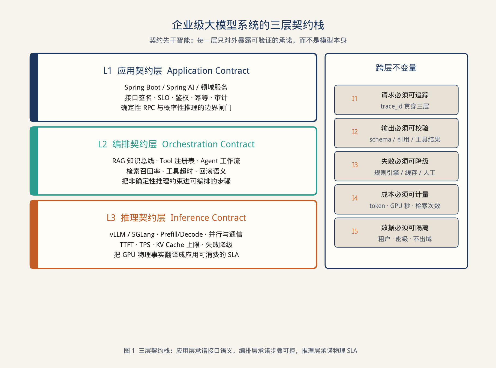

> **图 1** 三层各自的承诺，以及跨层都不能破坏的五条不变量。

| 层 | 对上承诺 | 对下依赖 | 承接需求 |
| --- | --- | --- | --- |
| 应用契约层 | 领域接口、鉴权、脱敏、路由、闸门、审计 | 编排层的结构化结果与错误码 | R1 R2 R6 R10 |
| 编排契约层 | 带引用的假设、有预算的工具过程、稳定错误码 | 推理层的补全能力与时限 | R3 R4 R5 |
| 推理契约层 | TTFT、TPOT、上下文上限、队列时限、降级模型 | GPU、并行策略、通信库 | R5 R7 |
| 控制面 | 指标、账单、链路、告警 | 三层都埋点 | R8 R9 |

控制面不是第四个业务层。它不产生处置建议，只保证三层的日志能对齐、账单能加总。第 7 章专门写它。

### 3.3 五条不变量

| 编号 | 不变量 | 在架构中的落点 |
| --- | --- | --- |
| I1 | 请求可追踪 | `trace_id` 由网关生成，检索、工具、推理调度原样传递 |
| I2 | 输出可校验 | 应用层用模式校验；编排层用引用存在性校验 |
| I3 | 失败可降级 | 路由表中每一档模型后面都有下一档，最后一档是规则或人工 |
| I4 | 成本可计量 | 网关在返回前写入 token、GPU 毫秒、检索次数、工具次数 |
| I5 | 数据可隔离 | 密级标签在网关生成，路由和检索过滤都读它，不允许下游改低 |

模型升级、向量库更换、GPU 代际更换，都通过替换某一层的实现完成。替换之后重新跑第 2.4 节的标准。不变量保持原编号，避免每次技术选型都重写架构说明。

### 3.4 一次请求的生命周期

下面 12 步是全文的主线。后文凡是写到某机制，都会标明它对应哪一步。NOC-Pilot 的走单示例也按这 12 步叙述。

| 步 | 发生位置 | 动作 | 失败时 |
| --- | --- | --- | --- |
| 1 | 应用层 | 鉴权，绑定租户与密级 | 401/403，不进入后续 |
| 2 | 应用层 | 脱敏，用令牌替换地址、口令、账号 | 脱敏失败则拒绝，禁止原文继续 |
| 3 | 应用层 | 查语义缓存与规则库 | 命中则直接返回，记账为缓存 |
| 4 | 应用层 | 按密级、难度、预算、SLO 选择推理平面 | 无可用平面则走 R6 退路 |
| 5 | 编排层 | 改写查询，做混合检索与重排 | 无合格证据 → `EVIDENCE_MISSING` |
| 6 | 编排层 | 把证据打成带编号的包，过滤过期与越权条目 | 仅剩过期证据 → `STALE_EVIDENCE` |
| 7 | 编排层 | 在预算内调用只读工具，更新证据包 | 超预算 → `BUDGET_EXHAUSTED` |
| 8 | 推理层 | 按 SLA 执行补全，流式返回 token | 超时或熔断 → 下一档模型或退路 |
| 9 | 编排层 | 解析为假设与草案，核对引用和对象名 | 无引用句 → `UNGROUNDED_CLAIM` |
| 10 | 应用层 | 模式校验；写草案只进入预览，不进入执行 | 校验失败计错误，不展示半截结果 |
| 11 | 应用层 | 高风险草案标记审批；原系统决定能否执行 | 窗口外或越权 → 草案保留但不可提交 |
| 12 | 控制面 | 审计落库，指标打点，账单累加 | 审计失败则本次结果不对外发布 |

第 12 步放在发布之前，是有意的。审计写失败仍把建议展示给值班人，事后会无法追责，等同于 I1 被破坏。宁可由网关返回“服务暂不可用”，也不发布一条没有档案的建议。

### 3.5 与现有微服务的关系

三层都是新进程或新模块，但领域状态留在原系统。

```text
告警总线 / 工单 / CMDB / 变更系统
        │  只读查询 + 审批提交
        ▼
应用契约层（网关 + 领域门面，Spring Boot）
        │  Advice / ErrorCode
        ▼
编排契约层（检索产品 + Agent 运行时）
        │  CompletionRequest + SLA
        ▼
推理契约层（推理网关 + 模型平面）
```

部署上允许编排层与应用层同进程，以减少一次内网跳转；逻辑边界仍按接口划分。推理层必须独立部署，因为它的扩容单位是 GPU，不是 Java 堆。

### 3.6 层间接口（总图级）

应用层看编排层：

```text
Advice advise(IncidentView incident, Budget budget)
ErrorCode ∈ {
  EVIDENCE_MISSING, STALE_EVIDENCE, TOOL_DENIED,
  BUDGET_EXHAUSTED, UNGROUNDED_CLAIM, MODEL_UNAVAILABLE
}
```

编排层看推理层：

```text
Completion complete(messages, responseSchema, Sla sla)
Sla = { maxInputTokens, maxOutputTokens, ttftMs, deadlineMs, modelClass }
```

推理层不理解“故障单”。它只理解消息、模式和时限。这样推理平台可以被客服、研运复用，领域语义留在上面两层。

> **本章要点**：三层加一个控制面。一次处置固定走 12 步，写操作停在第 11 步之前的草案。下一章展开第 1–4 步和第 10–12 步中属于应用层的部分。

---

## 4 应用契约层设计

> **本章任务**：定义业务系统看见的对象、网关和闸门，落实 R1、R2、R6、R10。

### 4.1 领域对象

应用层对外只有一个聚合：某张故障单上的一次 `Advice`。

```java
public enum AdviceKind {
    ROOT_CAUSE_HYPOTHESIS,
    ACTION_DRAFT,
    INSUFFICIENT_EVIDENCE
}

public record Advice(
        String adviceId,
        String incidentId,
        AdviceKind kind,
        String summary,
        List<Citation> citations,
        List<ActionDraft> drafts,
        List<String> evidenceIds,
        RouteInfo route,
        Cost cost
) {}

public record Citation(String evidenceId, String quote, String source, Instant validFrom, Instant validTo) {}

public record ActionDraft(
        String draftId,
        Risk risk,                 // LOW / MEDIUM / HIGH
        String intent,             // 给人读的意图，不是直接下发的命令
        String templateId,         // 必须来自命令模板库
        Map<String, String> args,  // 只能填模板参数
        boolean requiresApproval
) {}
```

几个约束写进类型，避免只写在提示词里：

- `kind = INSUFFICIENT_EVIDENCE` 时，`citations` 与 `drafts` 必须为空。
- 其他种类的 `citations` 不得为空。
- `ActionDraft.args` 的键必须是模板声明过的参数名。模板库里不存在的命令无法被表达，因此模型无法“发明”一条 `clear ip bgp` 除非该模板被显式收录且标成 HIGH。
- `requiresApproval` 由风险策略计算，模型无权把它改成 false。

`confidence` 不出现在对外对象里。早期方案曾让模型自报 0–100 的信心并据此放行，结果编造的地址同样可以得到高分。信心值如果用于内部路由，只保留在 `RouteInfo` 的调试字段，不参与第 11 步的放行。

### 4.2 网关的六项职责

所有到达模型的流量经过同一个网关。业务服务禁止持有厂商 SDK 的密钥。

| 顺序 | 职责 | 对应生命周期 | 实现要点 |
| --- | --- | --- | --- |
| 1 | 鉴权与租户 | 步 1 | 沿用现有 SSO 与数据权限，不单建账号体系 |
| 2 | 脱敏 | 步 2 | 地址、共同体、口令、账号替换为 `PEER$n` 这类令牌；令牌表只留在应用层 |
| 3 | 缓存与规则 | 步 3 | 键是规范化后的事件签名，不是原始问句；TTL 短于手册生效粒度 |
| 4 | 路由 | 步 4 | 决策顺序见 4.4 |
| 5 | 模式校验 | 步 10 | 反序列化失败即错误，不把原始文本回显 |
| 6 | 审计 | 步 12 | 原文哈希、脱敏文本、模型名、证据 ID、草案 ID、费用 |

网关的核心方法保持很薄，方便做契约测试：

```java
public Advice handle(IncidentView incident) {
    var ctx = auth.bind();                          // 步 1
    var safe = redactor.apply(incident, ctx);       // 步 2
    var cached = cache.find(safe.signature());      // 步 3
    if (cached.isPresent()) return audit.seal(cached.get(), Cost.CACHE);

    var route = router.choose(safe, ctx);           // 步 4
    Advice advice = orchestrator.advise(safe, route.budget()); // 步 5–9
    validator.check(advice);                        // 步 10
    gate.mark(advice, changeCalendar.now());        // 步 11
    return audit.seal(advice, route);               // 步 12
}
```

业务代码依赖 `IncidentAdvisor` 接口。Spring AI 的 `ChatClient` 或 LangChain4j 的 `AiServices` 都可以作为编排层内部的调用适配器，但适配器类型不得出现在领域模块的方法签名里。更换框架时，回归的是第 2.4 节的契约测试，而不是页面文案。

### 4.3 超时与流式

处置建议的延迟由两部分组成：开始吐字之前的等待，以及后续生成。用一个 3 秒的同步超时去套整个生成，结果不是被切断，就是把 Servlet 线程占满。

应用层因此区分三种调用：

| 类型 | 交互方式 | 超时 |
| --- | --- | --- |
| 值班追问 | SSE，先事件 `hypothesis`，再事件 `draft` | 首事件 2s，空闲 8s，总时长 30s |
| 已开单的自动建议 | 同步，因为证据通常已缓存 | 总时长 8s，超时升级为异步任务 |
| 班次复盘 | 队列 + `taskId` | 不占值班容量，截止时间 10 分钟 |

流里每一个事件都是完整 JSON，前端可以逐段渲染，但第 10 步的模式校验以“最后一个 `end` 事件携带的完整对象”为准。半截流不能写入工单。

### 4.4 路由顺序

路由是架构决策，顺序写死在策略里，避免每次事故临时改配置。

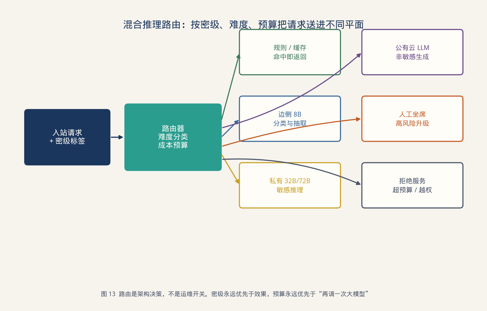

> **图 13** 路由按密级、缓存、难度、预算依次决定，高风险动作直接进入人工。

决策顺序：

1. 密级不允许出域：候选集删除全部公有云平面（R10）。
2. 规则或缓存能回答：直接返回（步 3）。
3. 分类器判定为已知告警码：边侧小模型做抽取，必要时套模板，不调用大模型。
4. 需要综合证据且预算允许：私有主模型。
5. 主模型熔断或排队超时：降到更小的私有模型；仍失败则 `MODEL_UNAVAILABLE`，工单进入人工队列（R6）。
6. 草案风险为 HIGH：无论模型档位，`requiresApproval = true`。

分类器本身用边侧小模型或规则，不允许为了“更准”去调用最贵的模型来决定要不要调用最贵的模型。

### 4.5 闸门

闸门是应用层对 R2 的实现，输入是 `ActionDraft`，输出是三种标记之一。

| 标记 | 条件 | 用户可见行为 |
| --- | --- | --- |
| `SUBMITTABLE` | 风险 LOW 或 MEDIUM，且位于变更窗口，参数均在白名单 | 显示“提交审批” |
| `BLOCKED` | 窗口外、对象无权限、模板为 HIGH 但无人值守 | 草案可见，按钮禁用，并给出原因 |
| `REJECTED` | 参数无法在 CMDB 中解析、模板不存在 | 草案不展示，记 `TOOL_DENIED` |

闸门的判定函数是纯函数，输入为草案、权限、日历和 CMDB 快照。它不调用模型。因此可以用表格测试覆盖全部组合。

### 4.6 应用层测试

| 测试 | 做法 | 挡住哪类回归 |
| --- | --- | --- |
| 契约测试 | 模式合法 / 缺引用 / 未知模板 ID | R1 |
| 闸门真值表 | 窗口、风险、权限的组合 | R2 |
| 路由单测 | 高密级样本断言候选集无公有云 | R10 |
| 故障注入 | 编排层返回每个错误码，断言 HTTP 与文案 | R6 |
| 黄金集回放 | 版本化提示词必须绑定黄金集哈希 | 提示词改动无可回归数据时禁止合并 |

> **本章要点**：应用层把采样结果收成 `Advice`，把写意图收成带模板 ID 的草案，再由纯函数闸门决定能否进入原系统。下一章说明证据和工具步骤如何在进入应用层之前被约束住。

---

## 5 编排契约层设计

> **本章任务**：设计检索数据产品和有界工具事务，落实 R3、R4、R5，并为应用层提供第 3.6 节的错误码。

### 5.1 编排层的输入输出

输入是脱敏后的故障视图和预算。输出是 `Advice` 或错误码。编排层可以读取拓扑、手册、日志和命令模板，不能连接变更系统的提交接口。它最多生成 `ActionDraft`。

内部分成两个子系统：

- **知识总线**：离线生产证据条目，在线按约束检索。
- **事务运行时**：在预算内决定要不要再读一次工具，以及何时停。

### 5.2 知识总线：离线

检索质量在离线阶段就基本确定。在线提示词无法补救一条没有作废日期的旧文档。

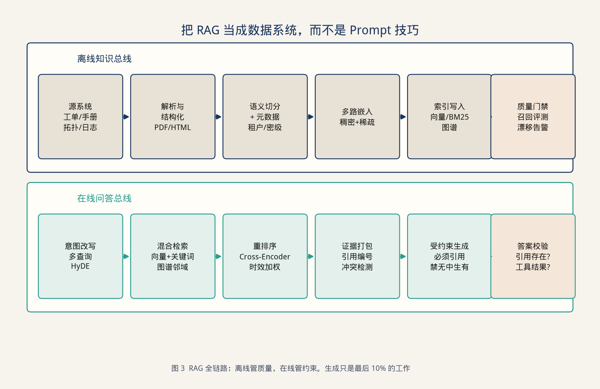

> **图 3** 上半是离线的证据生产，下半是在线的约束检索。生成位于这条流水线的末端。

一条证据的最小模式：

```text
Evidence {
  id, tenant, clearance,
  sourceSystem,          // RUNBOOK / VENDOR / POSTMORTEM / TOPOLOGY
  validFrom, validTo,    // validTo 为空表示现行
  product, software,     // 适用设备与版本
  title, body, commands[],
  contentHash, publishedAt
}
```

切分规则按结构而不是按固定长度：

- 一个告警码及其处理步骤保持在同一条。
- 一个命令块不被拦腰截断。命令块一旦被截断，模型会把前后两段拼成一条表面上合法的指令。
- 标题层级写入元数据，检索过滤可以限定“只查某设备家族的章节”。

发布按数据版本进行。每次发布记录新增、作废、切分变更，并在黄金集上回放召回。召回下降超过阈值则回滚索引。知识库的发布与业务版本使用同一套“可回滚”纪律。

### 5.3 知识总线：在线

在线固定六步，对应生命周期的步 5 和步 6。

1. **改写**。把“又抖了还是昨天那台”还原成设备 ID、告警码和时间窗。改写失败时退回原始词面，同时记下低置信，供重排保守处理。
2. **多路召回**。稠密向量、BM25、拓扑邻域各取候选。告警码和命令关键字通常是 BM25 更稳。
3. **打分**。

\[
score = \lambda s_{dense} + (1-\lambda) s_{bm25} + \beta \mathbf{1}[未过期] + \gamma \mathbf{1}[型号匹配]
\]

\(\lambda\) 不手拍。在黄金集上从 0.2 扫到 0.8。符号密集的告警场景里，最优 \(\lambda\) 常常落在 0.3 附近，说明只靠向量会把精确代码检索弄丢。

4. **重排**。用小模型或交叉编码器把约 50 条压到 5 条，并施加时间衰减。
5. **打包**。每条证据分配本次请求内的短编号 `E1…E5`，附带来源与生效期。总 token 超过预算时按分数截断，截断动作写入审计。
6. **资格过滤**。过期、越权、型号不匹配的条目可以出现在调试日志里，不能出现在交给模型的包里。

一个最小数值例子。三条候选在某次 BGP 抖动上的得分：

| 条目 | 稠密 | BM25 | 未过期 | 型号 | \(\lambda=0.3\) 后 |
| --- | --- | --- | --- | --- | --- |
| 2024 现行 SOP | 0.62 | 0.91 | 1 | 1 | 0.823 + \(\beta+\gamma\) |
| 2019 作废流程 | 0.88 | 0.40 | 0 | 1 | 0.544 + \(\gamma\) |
| 无关的光模块手册 | 0.71 | 0.15 | 1 | 0 | 0.318 + \(\beta\) |

取 \(\beta=\gamma=0.15\) 时，现行 SOP 为 1.123，作废流程为 0.694，无关手册为 0.468。作废流程即使向量更“像”，也会排到后面，并在第 6 步被资格过滤去掉。这就是 R3 在计算里的样子。

### 5.4 受约束生成与引用校验

模型收到的指令要求：每个结论句末尾标注 `[E#]`；出现的设备名、地址令牌、命令模板必须来自证据包或模板库；证据不足时输出 `INSUFFICIENT_EVIDENCE`。

校验器在应用进程内执行，不接受模型“自己保证引用属实”：

- 每个 `[E#]` 必须存在于本次证据包。
- 引用条目的 `validTo` 不得早于故障时间。
- 摘要里的设备令牌必须是输入视图或证据中出现过的。
- 草案的 `templateId` 必须存在，参数名必须是模板参数。

任一检查失败：若只是个别句子，删句后重试一次；若核心结论无引用，返回 `UNGROUNDED_CLAIM`。重试只允许一次，避免在错误证据上循环烧 token。

### 5.5 检索 SLO

| 指标 | 起点 | 含义 |
| --- | --- | --- |
| Recall@20 | ≥ 0.85 | 标准证据是否进入候选 |
| nDCG@5 | ≥ 0.70 | 前五条是否真相关 |
| 引用覆盖率 | ≥ 0.90 | 结论句能否指回证据 |
| 过期引用率 | ≤ 0.02 | 用专门的负样本度量 |
| 空证据拒答率 | ≥ 0.95 | R4 |

这些数是发布门槛，不是汇报用的装饰。门槛未达到时，编排层仍可在灰度租户运行，但不能打开自动草案。

### 5.6 工具事务

多步推理采用固定阶段，而不是开放式的“模型自己决定聊到何时”。

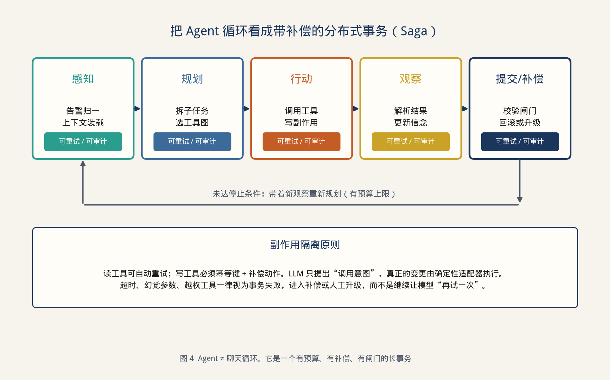

> **图 4** 感知、规划、行动、观察、提交或补偿。每一阶段可审计，循环有预算。

| 阶段 | 允许的动作 | 停条件 |
| --- | --- | --- |
| 感知 | 装载故障视图与已有证据 | 视图缺关键对象则直接拒答 |
| 规划 | 选择下一个只读工具或决定停止 | 预算见下表 |
| 行动 | 调用只读工具；写工具只返回预览，且必须是模板 | 工具错误码原样向上 |
| 观察 | 把工具结果并入证据包，重新校验资格 | 新证据越权则丢弃 |
| 提交 | 生成 `Advice` 草稿交给步 9 的校验 | 校验失败走补偿：丢弃草案，保留审计 |
| 补偿 | 不修改外部状态；清理本次临时上下文 | 始终可执行 |

预算的默认值：

| 项 | 交互建议 | 复盘任务 | 超出之后 |
| --- | --- | --- | --- |
| 规划步数 | 6 | 12 | `BUDGET_EXHAUSTED`，返回已有证据 |
| 只读工具次数 | 8 | 20 | 同上 |
| 写预览次数 | 1 | 2 | 拒绝继续预览 |
| 墙钟 | 20 秒 | 8 分钟 | 取消未完成工具 |
| 提交次数 | 1 | 1 | 禁止第二次“再写一版” |

读工具可以在幂等前提下重试一次。写预览不自动重试，因为重复预览会在界面上制造两份互相矛盾的草案。

运行时只挂载当前角色的工具。值班账号的工具清单里没有变更提交。实习账号的清单里没有日志原文，只有脱敏摘要。工具清单是权限的一部分，随步 1 的身份绑定，模型不能在对话中“申请开通”。

### 5.7 何时拆成多个运行时

NOC-Pilot 使用三个运行时，因为它们的工具集、风险和评测集都不同。

| 运行时 | 只读工具 | 写预览 | 评测重点 |
| --- | --- | --- | --- |
| 根因 | 拓扑、手册、日志窗口 | 无 | 引用覆盖、拒答 |
| 变更 | 变更日历、命令模板 | `preview` 一次 | 模板合法率、HIGH 标记率 |
| 报告 | 已发布的 Advice 与工单字段 | 无 | 事实与 Advice 一致，不新增结论 |

拆分的判据很具体：两边如果不能各自画出输入模式和输出模式，就仍然是同一运行时里的两段提示词。为了“角色扮演”再增加互相对话的角色，只会增加交接时的编造，并让 trace 被拆碎。

### 5.8 错误码到人话

编排层不产生自由格式的失败说明。应用层按下表生成值班人员能读的句子。

| 错误码 | 含义 | 界面文案要点 |
| --- | --- | --- |
| `EVIDENCE_MISSING` | 过滤后没有证据 | 说明缺哪类资料，例如“无该软件版本的现行手册” |
| `STALE_EVIDENCE` | 只命中过期条目 | 提示条目已作废，给出作废时间 |
| `TOOL_DENIED` | 工具不在角色清单或参数非法 | 不展示模型原话 |
| `BUDGET_EXHAUSTED` | 步数或时间用尽 | 展示已收集证据，建议转人工 |
| `UNGROUNDED_CLAIM` | 结论无法绑定引用 | 不展示该结论 |
| `MODEL_UNAVAILABLE` | 推理平面无容量 | 进入 R6 退路 |

> **本章要点**：证据先按时间、型号、密级成为数据产品，再进入模型；工具过程是有预算的事务，写操作停在预览。下一章说明步 8 的补全能力本身如何被容量和延迟约束。

---

## 6 推理契约层设计

> **本章任务**：把 GPU 上的两种计算、显存和并行，翻译成编排层能填写的 SLA。落实 R5 的时限部分和 R7。

推理层的调用方是编排层。它不解析故障单，只接受消息、模式和时限，返回 token 流、用量和实际命中的模型名。内部可以替换推理引擎，只要 SLA 字段保持稳定。

### 6.1 两种计算状态

一次补全由预填充（Prefill）和解码（Decode）衔接而成。它们的瓶颈不同，容量规划必须分开写。

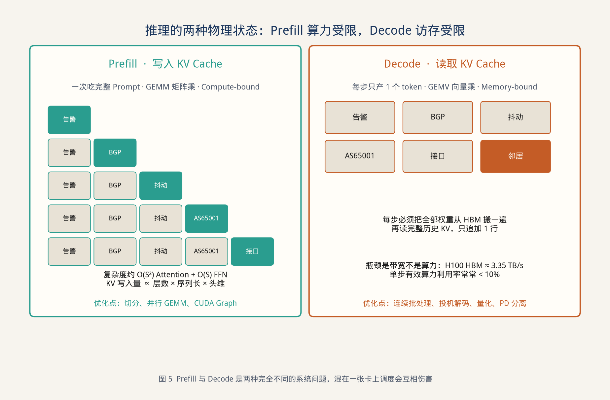

> **图 5** 预填充一次处理整段输入并写入 KV；解码每步只生成一个 token，并反复读取历史 KV。

| | 预填充 | 解码 |
| --- | --- | --- |
| 输入形状 | 整段提示 | 上一步的一个 token |
| 主要算子 | 矩阵乘 GEMM | 向量乘 GEMV |
| 常见瓶颈 | 算力 | 显存带宽 |
| 用户感知 | 首 token 时间 TTFT | 后续每个 token 的间隔 TPOT |
| 被什么拖垮 | 超长日志、长手册原文 | 并发路数 × 上下文长度 |

H100 的 HBM 带宽约 3.35 TB/s。解码的每一步都要把权重从显存搬进计算单元，再读出全部历史 KV。只增加算力、不增加带宽和 KV 容量的升级，对解码吞吐帮助有限。

对应用 SLA 的对应关系：

| 用户看到的现象 | 主要原因 | SLA 字段 |
| --- | --- | --- |
| 迟迟不出第一个字 | 排队或预填充过长 | `ttftMs`、`queueMs` |
| 出字后一顿一顿 | 解码带宽不足或批次被打散 | `tpotMs` |
| 长复盘特别慢 | 预填充算力 | `maxInputTokens` 与独立队列 |
| 一忙全部卡住 | 长预填充与交互解码共享批次 | 队列隔离，见 6.5 |

### 6.2 用 KV 而不是 QPS 做容量单位

并发上限由 KV Cache 决定。单请求占用近似为：

\[
\text{KV} = 2 \times L \times S \times n_{kv} \times d_h \times \text{dtype}
\]

\(L\) 为层数，\(S\) 为序列长度，\(n_{kv}\) 为 K/V 头数，\(d_h\) 为头维，dtype 为每元素字节数。

**算例。** 一组与 32B 量级模型相近的结构参数：\(L=64\)，\(n_{kv}=8\)，\(d_h=128\)，dtype = 2 字节。

| 序列长度 | 单请求 KV | 80GB 卡扣除权重后若余 40GB，约可并发 |
| --- | --- | --- |
| 2K | 0.50 GB | 约 80 路（还会被批次和预填充限制，实际取更小值） |
| 8K | 2.0 GB | 约 20 路 |
| 32K | 8.0 GB | 约 5 路 |

计算过程：\(2 \times 64 \times 8192 \times 8 \times 128 \times 2 = 2\,\text{GiB}\)。上下文从 2K 增到 8K，能同时住在卡上的路数大约降到四分之一。因此“模型支持 128K 上下文”和“以 128K 上下文提供 50 路并发”是两句不同的承诺。推理契约里两者都要写明。

编排层能做的最大节省，是在步 6 把证据包压到预算内。NOC-Pilot 把平均输入从直接拼接日志的约 41K token 降到约 6K token，主平面的可并发路数随之上升。这一步发生在 Java 服务里，不需要改 CUDA。

降低 KV 的结构手段与系统手段可以叠加，但是选型结论要写进模型准入，而不是写进业务代码：

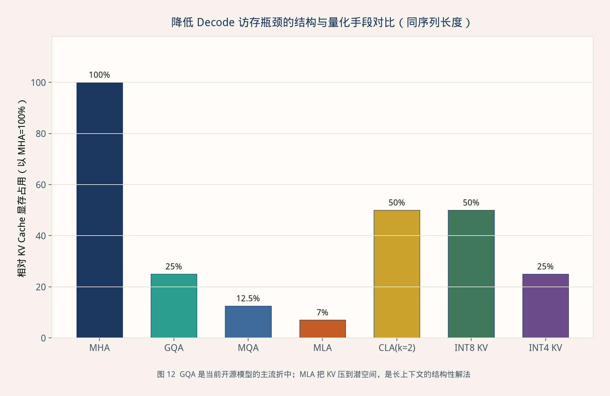

> **图 12** 分组查询注意力（GQA）是当前开源模型的常见折中；多头潜变量注意力（MLA）把 KV 压到低维后再缓存，适合长上下文。

| 手段 | 作用 | 架构师要确认的事 |
| --- | --- | --- |
| GQA / MQA | 多个 Query 头共享较少的 K/V 头 | 准入模型的 \(n_{kv}\) 是多少 |
| MLA | 缓存低维潜变量，解码时再展开 | 推理引擎是否支持该结构 |
| 跨层共享 | 若干层复用同一份 KV | 质量回退是否在黄金集上可接受 |
| KV 量化 | INT8 / INT4 降低字节数 | 引用覆盖率是否仍过门槛 |
| 分页缓存 | 按页分配，减少碎片 | 引擎是否启用 PagedAttention 一类机制 |

### 6.3 并行策略

单卡放不下权重时才引入并行。三种并行切开的对象不同，通信也不同。

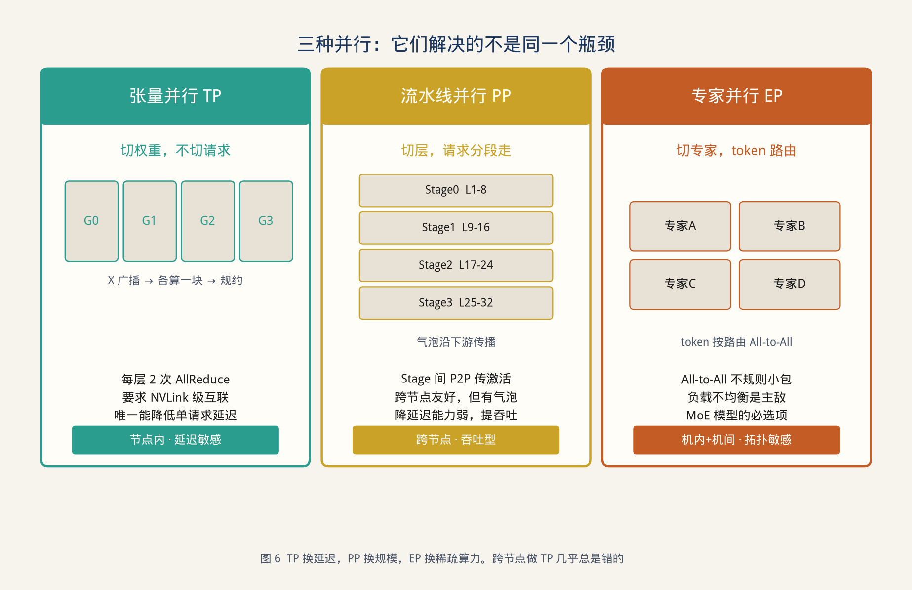

> **图 6** 张量并行用来降低单请求延迟，流水线并行用来跨节点扩展吞吐，专家并行用来放置稀疏模型。

| 策略 | 切开的对象 | 通信 | 适合 | 避免 |
| --- | --- | --- | --- | --- |
| 张量并行 TP | 层内权重 | 每层两次 AllReduce，频率高 | 节点内 NVLink，交互要低延迟 | 跨节点、仅有 PCIe 的机器 |
| 流水线并行 PP | 连续的层 | 阶段之间点对点传递激活 | 跨节点扩规模、批量吞吐 | 小批量且要求低延迟的值班问答 |
| 专家并行 EP | 混合专家模型中的专家 | All-to-All，包小且不规则 | 模型本身是 MoE | 没有负载均衡手段时硬拆 |

评审时使用两条判据。

第一，交互链路若要降低单请求延迟，优先在节点内做 TP。PCIe 与 NVLink 的带宽相差一个数量级，在 PCIe 上做 TP，通信会把并行省下的时间吃回去。

第二，流水线的空泡会向下游传递。阶段之间算力不齐时，空转无法在本阶段消化。微批数量明显大于阶段数时，空泡比例才下降。值班问答的批量很小，这个条件经常不成立，所以 NOC-Pilot 的交互平面不做跨节点流水线。

生产上的常见组合是：节点内 TP（MoE 再加 EP），节点之间用副本或预填充/解码分离，而不是把十几张卡做成一个巨大的 TP 组。

### 6.4 通信栈与成本模型

一次 AllReduce 从框架调用穿过通信库、算法、协议，最后落到 NVLink、NVSwitch、InfiniBand 或 RoCE。

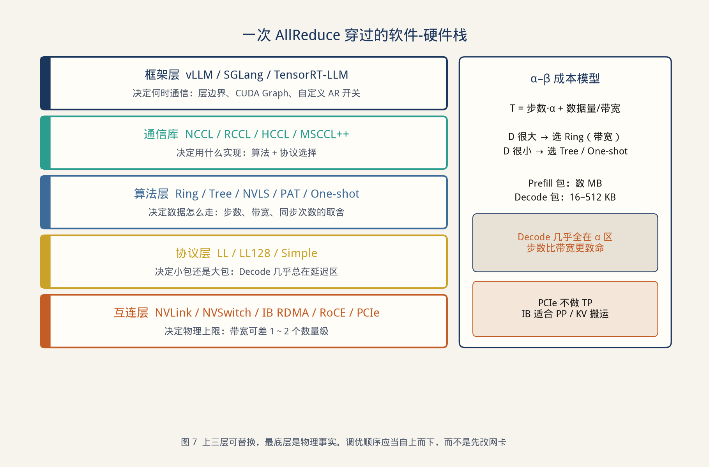

> **图 7** 框架、通信库和算法可以替换；互连带宽是物理上限。

延迟可按 \(\alpha\)–\(\beta\) 模型估计：

\[
T = \text{步数} \times \alpha + \frac{\text{数据量}}{\text{带宽}}
\]

预填充的激活包可达数 MB，带宽项主导，环算法更合适。解码的包常常只有几十到几百 KB，落在固定开销 \(\alpha\) 主导的区域，步数更少的树算法、一次或两次同步的自定义规约、或交换机内规约更合适。

因此“通信慢”需要先分成两类工单：预填充大包慢，还是解码小包慢。两类的改法不同。通信库的拓扑探测和缓冲注册只在进程启动时做一次。若每个请求都重新初始化通信组，TTFT 会被启动过程占满。这与数据库连接池的用法相同：池在进程生命周期内复用。

多芯片环境下通信库名称不同，判据不变。NVIDIA 使用 NCCL 与 NVLink，华为使用 HCCL 与 HCCS，AMD 使用 RCCL。应用架构只保留三条：节点内高带宽才做 TP；节点间做副本、流水线或 KV 搬运；通信组未就绪时推理平面标记为不可用，路由不得把流量送进去。

### 6.5 预填充与解码分离

交互问答和长复盘如果共用一个批次，长预填充会把解码的连续批打断，交互 TTFT 出现尖刺。分离的做法是：预填充副本负责把输入变成 KV，解码副本负责逐 token 生成，两者之间搬运 KV。

对编排层仍然是一次 `complete()`。SLA 增加两个观测字段：`prefillQueueMs` 与 `kvTransferMs`。当搬运时间经常大于解码本身，说明两段副本离得太远或批太碎，应把它们放回同一高速互联域。

分流规则：

| 输入规模 | 放置 |
| --- | --- |
| ≤ 2K 且要求低 TTFT | 预填充与解码都在交互副本，避免搬运 |
| ≥ 8K 的复盘 | 进入预填充池，KV 再迁到解码池 |
| 超过平面声明的 `maxInputTokens` | 拒绝或先由编排层摘要，禁止“试着塞进去” |

这条规则落实 R7：批处理可以排队，不准把值班问答的首 token 时间拖过 SLA。

### 6.6 投机解码

解码慢，是因为每生成一个 token 都要搬运一次目标模型的权重。投机解码让一个便宜的草稿模型先提出若干 token，再由目标模型用一次前向并行验证。接受最长的一致前缀；第一个被拒绝的位置之后全部丢弃，并从残差分布补一个 token。拒绝采样保证输出分布与原模型一致，变化的是权重搬运次数。

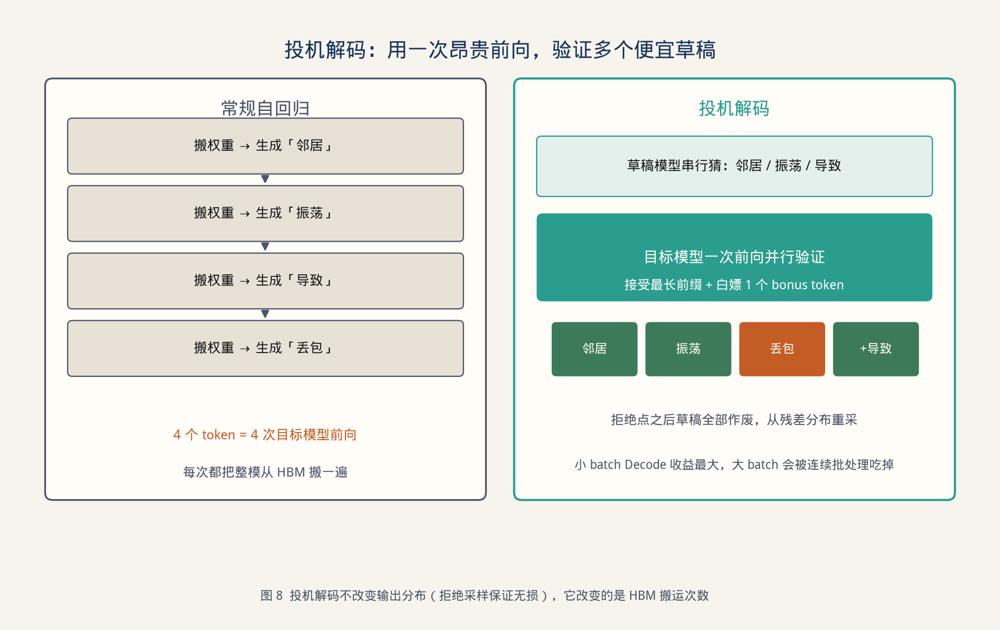

> **图 8** 草稿模型串行提议，目标模型一次验证。被拒绝的位置之后草稿作废。

推理契约里它是一个开关，带三个准入条件：

1. 流量以小批量解码为主。值班追问符合；大批量复盘通常已经能把权重搬运摊薄，开关收益下降。
2. 草稿模型与目标模型的分词器一致。不一致则“分布不变”在工程上不成立。
3. 观测里报告平均接受长度。接受长度接近 1 时，开关只增加一次草稿开销，应关闭。

NOC-Pilot 在交互平面打开该开关，在复盘平面关闭。第 8 章给出接受长度的观测值。

### 6.7 对编排层公开的 SLA

推理平面注册时提交一份清单，路由器只读这份清单：

```text
modelClass: private-32b
maxInputTokens: 24000
maxOutputTokens: 2000
ttftP95Ms: 800
tpotP95Ms: 35
kvBudgetMb: 180          # 按约定的输入长度折算
concurrencyTarget: 48
queueTimeoutMs: 2000
degradedModelClass: private-14b
pdSplit: true
speculativeDecode: interactive-only
```

编排层超预算的请求在进入步 8 之前就被缩小或拒绝。推理层过载时按 `queueTimeoutMs` 失败，路由器执行 4.4 节的下一档。GPU 换代或并行度调整，只更新这份清单和容量数字，不改故障单接口。

> **本章要点**：推理层向上只提供带 TTFT、TPOT、上下文上限和降级档的补全能力。容量按 KV 计算，交互与长文本分队列，跨节点不做张量并行。下一章把三层的运行数据收成一个控制面。

---

## 7 控制面设计

> **本章任务**：把稳定、成本、安全和可观测做成跨层机制，落实 R6 的退路演练、R8 和 R9。控制面不产生新的处置语义。

### 7.1 稳定性：模型平面是会抖动的下游

| 机制 | 作用对象 | 参数来源 | 触发后的行为 |
| --- | --- | --- | --- |
| 限流 | 租户 | 日 token 预算与并发槽 | 超限返回配额错误，不排队把别人拖死 |
| 熔断 | 单个模型平面 | TTFT 与错误率 | 该平面从路由候选中摘除，流量进入下一档 |
| 隔离 | 交互队列 / 复盘队列 | 6.5 的分流规则 | 复盘只在自己的池里排队 |
| 超时 | 每一次补全 | SLA 的首 token 与总时长分开 | 超时即失败，不无限挂起流 |
| 重试 | 只读工具与网络错误 | 编排层预算 | 写预览不重试 |

降级链写成显式清单，并在预生产做切断演练：

```text
private-72b → private-32b → edge-8b → rule-engine → human-queue
```

每一跳把原因写入审计。没有原因码的降级，账单和事后复盘都无法解释“为什么今天建议变短了”。

### 7.2 成本模型

单次请求的成本：

\[
C = c_{token} + c_{gpu} + c_{retrieval} + c_{human}
\]

四项放在同一张账单里。只比较 API 单价，会把所有请求推向最大的模型：单次文本更完整，系统总成本更高。

NOC-Pilot 在预生产用同一批脱敏故障单比较六种策略。纵轴是端到端 P95 时延，横轴是每千张单的综合成本。

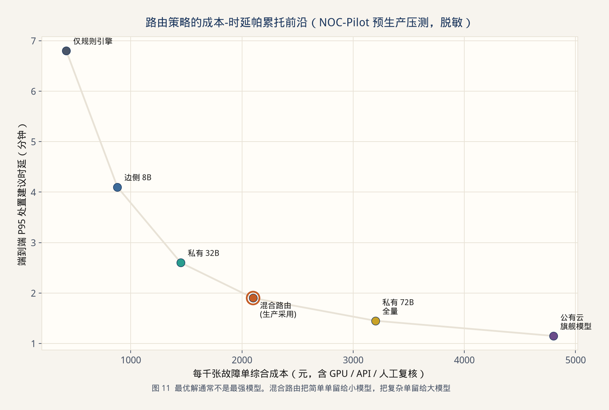

> **图 11** 六种策略里，混合路由位于曲线的拐点附近。全量最大模型继续花钱，时延下降变慢。

| 策略 | 每千单成本 | P95 时延 | 人工升级率 | 是否采用 |
| --- | --- | --- | --- | --- |
| 仅规则 | ¥420 | 6.8 分钟 | 41% | 作为最后一档退路，不单独使用 |
| 边侧 8B | ¥880 | 4.1 分钟 | 29% | 用于分类和抽取 |
| 私有 32B 全量 | ¥1,450 | 2.6 分钟 | 18% | 作为混合路由的主档 |
| 混合路由 | ¥2,100 | 1.9 分钟 | 11% | 采用 |
| 私有 72B 全量 | ¥3,200 | 1.45 分钟 | 9% | 只接待分类器判定的复杂单 |
| 公有云旗舰全量 | ¥4,800 | 1.15 分钟 | 8% | 密级策略不允许作为默认 |

混合路由能落在拐点，是因为难度分布偏斜：约六成是已知告警码，两成需要手册综合，约一成需要多步工具，其余必须人工。用 72B 回答已知告警码，是在用 GPU 重复规则引擎已经覆盖的分支。

账单维度至少包括租户、模型档、是否缓存、是否人工。财务按月导出，与网关日志条数核对，满足 R8。

### 7.3 安全：把不可信文本留在数据通道

故障日志和手册都可能含有“忽略以上要求”这类句子。模型如果把它们当成指令，会试图调用清单之外的工具。应用层已经没有写连接，仍需要编排层减少无效尝试，并把越权记入审计。

| 控制 | 位置 | 行为 |
| --- | --- | --- |
| 通道分离 | 步 8 的消息结构 | 系统约束、工具清单、用户事件、证据分栏存放 |
| 证据降权 | 步 6 | 证据正文只作为数据；出现指令语气的段落仍只是正文 |
| 工具清单 | 步 7 | 由身份决定，模型不能增删 |
| 出站闸门 | 步 11 | 即使模型被干扰，草案仍要过模板、对象和日历 |
| 密级 | 步 2 与步 4 | 标签只允许保持或拒绝，不允许降级后出域 |
| 最小明文 | 步 2 | 公有云路径上只出现令牌化文本；高密级根本不进入该路径 |

误杀的表现是拒答，漏放的表现是一份非法草案进入审批甚至更远。闸门策略按“宁可拒答”配置。审批人仍然可能点错，那是原变更系统的控制，不在模型服务内放宽。

### 7.4 可观测：三条时间线

“慢”和“错”需要能定位到层。只保留一条 HTTP 耗时，无法决定该调检索、工具、队列还是解码。

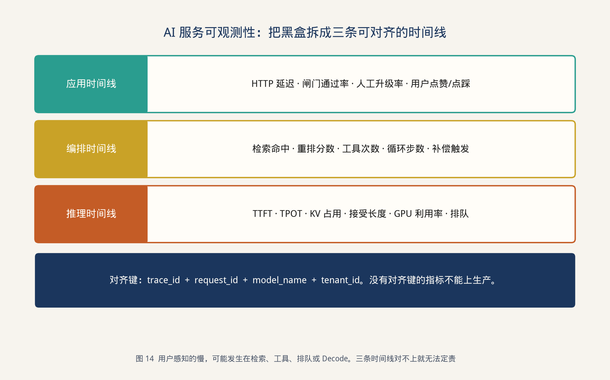

> **图 14** 应用、编排、推理三条时间线用同一组键对齐。

| 时间线 | 必采指标 | 典型告警 |
| --- | --- | --- |
| 应用 | 端到端 P95、闸门拦截率、人工升级率、缓存命中率 | 升级率周环比上升 |
| 编排 | 空检索率、过期过滤条数、工具错误码、规划步数 | 空检索率超过 10% |
| 推理 | TTFT、TPOT、排队、KV 占用、GPU 利用率、投机接受长度 | TTFT P95 超过 SLA 连续 5 分钟 |

对齐键为 `trace_id`、`request_id`、`model_class`、`tenant_id`。新指标若不能带上这四个键，就不进入生产看板，否则会出现无法下钻的曲线。

一次排障按固定顺序：先看应用时间线确认是哪一张单，再用 `trace_id` 看编排是否空检索或超步数，最后看推理是排队还是解码。第 2.4 节的 R9 要求这个过程在 10 分钟内完成，演练时抽查。

> **本章要点**：降级链、统一账单、密级路由和三线观测把三层合成一个可运营的服务。下一章把第 2 章的需求逐条映射到 NOC-Pilot 的实现和数字。

---

## 8 设计验证：NOC-Pilot

> **本章任务**：把三层契约实例化成网络故障智能处置系统，并用 R1–R10 验收。

### 8.1 系统目标

环境为企业网与专线混合组网。日均有效告警约 1.2 万条，收敛后 800 至 1200 张故障单。原系统已经具备网管、CMDB、日志、厂商文档和变更单。值班的成本主要花在五个界面之间复制上下文。

NOC-Pilot 的目标写在需求范围里：

- 做告警之后的根因假设、处置草案和班次复盘草稿。
- 不做自动改路由、自动重启设备、自动关闭工单。

第二句保证采样轨道没有生产写连接，对应 R2。

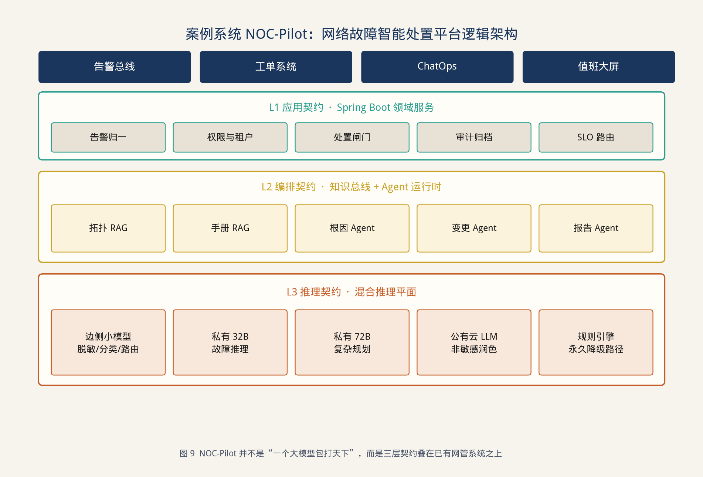

> **图 9** 系统叠在告警、工单、ChatOps 和大屏之上。领域服务、知识与工具、推理平面分成三层。

### 8.2 需求到模块的映射

| 需求 | NOC-Pilot 中的实现 | 验收方式 |
| --- | --- | --- |
| R1 | `Advice` 模式 + 网关反序列化 | 契约测试全通过才允许发布 |
| R2 | 草案模板 ID + 纯函数闸门 + 原变更审批 | 灰度期间非法变更单数为 0 |
| R3 | 证据模式含生效期、型号、密级 | 索引抽查缺失率为 0 |
| R4 | 资格过滤 + 引用校验 + 黄金集 | 无引用回答率、拒答率 |
| R5 | 三套运行时预算 | 故障注入超步数，断言错误码 |
| R6 | 降级链末端是规则与人工队列 | 切断 32B 平面的演练 |
| R7 | 交互平面与复盘平面分离 | 复盘高峰期的交互 TTFT |
| R8 | 网关账单按租户导出 | 与日志条数对账 |
| R9 | 三线指标同一 `trace_id` | 抽查慢请求定位时间 |
| R10 | 路由单测 + 高密级不进公有云 | 策略用例 |

### 8.3 部署

| 平面 | 资源 | 并行与队列 | 服务的请求 |
| --- | --- | --- | --- |
| 边侧 | 1 张推理卡，8B 量化 | 单卡 | 脱敏辅助、难度分类、字段抽取 |
| 交互主平面 | 单机 8 卡 | 节点内 TP=4，其余做副本；开启投机解码 | 32B 值班建议 |
| 复杂与复盘平面 | 两机各 8 卡 | 节点内 TP=8，节点间不组 TP；关闭投机解码 | 72B 复杂单，以及 ≥8K 的复盘预填充 |

节点之间不做张量并行，避免 AllReduce 走跨机网络。复盘不进入交互副本。

### 8.4 按 12 步走一张 BGP 抖动单

**步 1–2。** 告警总线把 26 条会话抖动收敛成一张故障单。网关写入 `tenant=backbone`、`clearance=internal-only`。邻居地址替换为 `PEER$04`。令牌表留在应用层，证据和模型都只看见令牌。

**步 3–4。** 6 小时内没有相同签名的缓存。密级使公有云不在候选集。分类器给出中等难度，路由器选择 `private-32b`，预算为 6 步、20 秒。

**步 5–6。** 查询被改写成告警码、软件版本 `IOS-XR 7.8` 和设备 `PE-13`。混合检索召回拓扑邻域 4 条、现行手册 2 条、2024 年复盘 1 条。2019 年流程的向量分更高，但“未过期”项为 0，资格过滤将其移出证据包。最终 5 条证据，约 5.6K token。

**步 7。** 根因运行时调用两次只读工具：15 分钟日志窗口、对端接口错误计数。证据已足够形成假设，运行时在剩余预算用完之前停止。

**步 8。** 交互平面 TTFT 620 毫秒。投机解码平均接受长度 2.4。本请求 KV 约 96 MB。同一时刻的班次复盘在另一平面排队。

**步 9–10。** 输出种类为根因假设，引用 `[E1,E3,E4]`，校验器核对全部存在且未过期。变更运行时给出一份草案：关闭对端错误接口，等待恢复后再打开。`clear ip bgp` 对应的模板被标为 HIGH。

**步 11–12。** 闸门读取变更日历，当前不在窗口内，草案标记为 `BLOCKED`，按钮禁用，原因是“窗口外且风险为 HIGH”。审计写入 trace、模型档、token、证据 ID 和闸门原因。工单状态机没有任何自动迁移。

这张单的采样只发生在步 7 和步 8。前后都是鉴权、过滤、校验和审批。设计要的就是这个形状。

### 8.5 六周灰度结果

| 指标 | 接入前 | 第六周 | 与需求的关系 |
| --- | --- | --- | --- |
| 人均处理停留时间 | 11.4 分钟 | 6.9 分钟 | 综合效率，含阅读建议的时间 |
| 一线可独立关闭比例 | 44% | 63% | 假设确实减少了升级 |
| 错误草案率 | — | 1.7% | 全部被闸门拦住，未形成变更单（R2） |
| 无引用回答率 | 第一周 18% | 1.1% | 引用校验上线后的 R4 |
| 空证据拒答率 | — | 0.97 | 达到 2.4 节起点 |
| 交互平面 GPU 利用率 | 19% | 54% | 分流之后解码批次更完整（R7） |
| 每千单综合成本 | — | ¥2,100 | 低于 72B 全量约 34%（R8） |
| 切断 32B 后简单单的规则命中 | — | 保持可用 | R6 演练通过 |
| 高密级路由到公有云的次数 | — | 0 | R10 |

停留时间的下降同时包含“建议有用”和“少切几个系统”。非法变更单为零，说明效率提升没有换来一次错误下发。

### 8.6 四次设计返工

返工记录说明哪些条款是被事故逼出来的，避免下一套系统重犯。

**返工 1：日志原文进入上下文。** 单次把约 20 万行日志送入 32B，KV 把并发压到个位数，TTFT 越过 SLA。改为“设备 + 时间窗 + 告警码”的证据摘要后，平均输入约 6K token，引用覆盖率上升。结论写进编排层：上下文预算是设计参数，不是模型窗口的上限。

**返工 2：复盘与值班共用副本。** 早班复盘的预填充把值班 TTFT 打到秒级以外。按 6.5 节拆队列之后恢复。结论写进推理契约：R7 是部署约束，不是运行时的最佳努力。

**返工 3：黄金集只有书面问法。** 上线后出现“又抖了还是昨天那台”。改写器缺失时检索为空，模型开始补写设备。黄金集补充口语、缺主语和错别字之后，改写器才有回归数据。结论写进发布门槛：黄金集与提示词版本绑定。

**返工 4：用自报信心放行。** `confidence ≥ 80` 的草案曾经自动进入审批。编造的邻居参数同样可以获得高分。信心字段移出放行函数，闸门只看模板、CMDB 和日历。结论写进 4.1 节的对象模型。

> **本章要点**：NOC-Pilot 是三层契约的一个实例。十二条生命周期走完一张单，十条需求都有模块和数字对应。下一章把实例拆成团队可以分期交付的出口条件。

---

## 9 实施路径

> **本章任务**：给出从第一周网关到第六周灰度的构建顺序。每一阶段都有可以演示的出口，避免同时开工三层却没有一条需求被验收。

### 9.1 阶段

| 阶段 | 时间盒 | 交付 | 出口条件 | 覆盖需求 |
| --- | --- | --- | --- | --- |
| 1. 门面 | 第 1 周 | 网关、`Advice` 模式、审计骨架 | 契约测试可运行；业务代码不再拼接提示词 | R1 R9 的键已生成 |
| 2. 证据 | 第 2–3 周 | 证据模式、混合检索、黄金集 ≥ 150 | 过期负样本的过滤可演示 | R3 R4 的离线部分 |
| 3. 校验 | 第 4 周 | 引用校验、错误码、界面文案 | 无引用样本不再展示 | R4 |
| 4. 事务 | 第 5 周 | 只读运行时与预算 | 超步数注入得到 `BUDGET_EXHAUSTED` | R5 |
| 5. 闸门 | 第 6 周 | 模板库、纯函数闸门、审批按钮 | 非法模板无法提交 | R2 |
| 6. 平面 | 与 4、5 并行 | SLA 清单、两级队列、降级链 | 切断主平面，简单单仍有规则答案 | R6 R7 |
| 7. 灰度 | 之后六周 | 单租户灰度、账单、三线看板 | 第 8.5 节的指标开始按周记录 | R8 R10 |

阶段 6 与阶段 4 并行，是因为推理容量由基础设施同学实施，接口以 6.7 节的清单为准。应用同学用一个假的推理桩即可先完成闸门。桩返回合法 JSON 和固定时延，契约测试不依赖 GPU。

### 9.2 人员分工

| 角色 | 负责的契约 | 不负责 |
| --- | --- | --- |
| 领域后端 | 对象、网关、闸门、错误码文案 | 不改 GPU 拓扑 |
| 知识工程 | 证据模式、切分、黄金集、召回回放 | 不直接改审批流 |
| 推理平台 | SLA 清单、队列、并行、投机解码开关 | 不解析故障单字段 |
| 值班负责人 | 黄金集里的标准证据、HIGH 模板清单 | 不编写提示词原文 |
| 安全 | 密级、脱敏规则、出域策略 | 不放宽闸门以换取回答率 |

发生争议时回到需求编号。例如“为了回答率希望放行无引用结论”，对应的是放宽 R4。这需要值班负责人明确接受风险并修改验收标准，而不是在提示词里悄悄删掉引用要求。

### 9.3 能力上的增量

实施这套架构，后端原有的接口治理、超时、幂等、权限、灰度和容量方法继续使用。需要新增的是一层推理侧的数量直觉，以及把评测从单次断言扩展为黄金集。

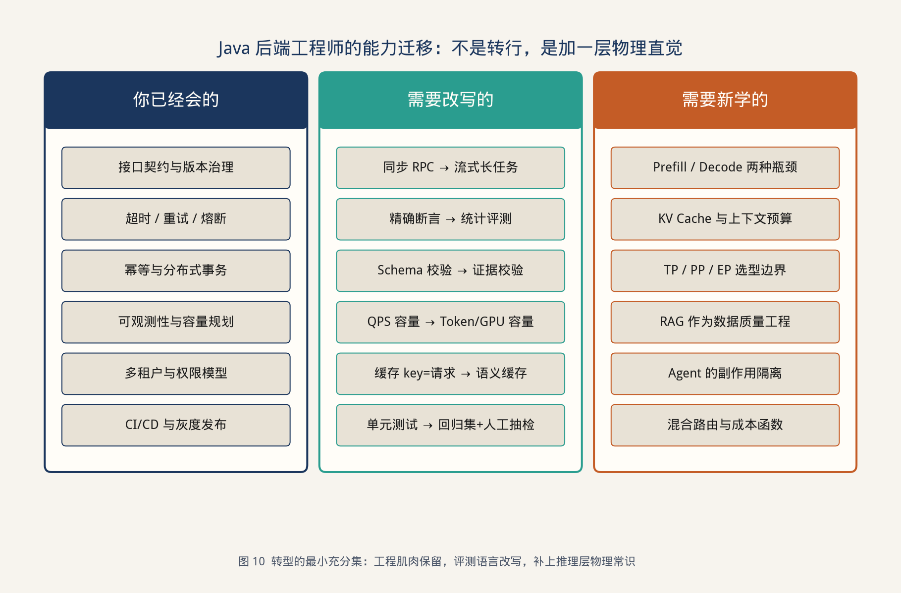

> **图 10** 左列是实施中直接复用的能力，中列是同一能力在新服务中的形态，右列是为了填写 SLA 而新增的概念。

新增概念集中在第 6 章，范围控制在容量与路由所需，不扩展到算子实现。评测形态的变化集中在第 4.6 节和第 5.5 节：提示词和索引都按版本回放。

> **本章要点**：按门面、证据、校验、事务、闸门、推理平面的顺序交付，每阶段都有出口条件。下一章说明这套设计在哪些前提下成立，以及它不打算解决的问题。

---

## 10 讨论与局限

> **本章任务**：标明设计的适用条件，避免把 NOC-Pilot 的结论推广成所有业务的默认架构。

### 10.1 适用条件

这套架构适合同时满足下面四条的系统：

1. 已有确定的业务状态机，模型只是旁路建议者。
2. 错误建议会带来真实损失，因此需要闸门，而不是只需要一个聊天窗口。
3. 知识有版本和权限。没有版本的闲聊语料用这套数据产品会过重。
4. 请求的延迟和成本需要按租户管理。个人助手不必上三层。

客服知识问答、变更审核、运维处置、合同条款核对，通常满足这四条。开放域闲聊、营销文案生成，只有 R1 和成本账单仍然有用，R2 和引用校验可以按风险裁剪。裁剪时保留需求编号，标明“本系统不验收 R2”，而不是把闸门代码留在仓库里却不调用。

### 10.2 局限

**黄金集的覆盖。** 六周数据来自预生产流量，口语和新型告警仍会持续出现。引用覆盖率是门槛，不是对未知故障的正确率保证。新型故障的设计行为是拒答或升级，而不是必须给出根因。

**模板库的完备性。** 闸门的安全性依赖于 HIGH 命令都已经入库并标级。未入库的危险命令，模型无法通过 `templateId` 表达，这是优点；值班人员临时发明的合法新命令，也会被拒绝，直到模板库更新。这是用灵活性换 R2。

**推理数字的时效。** KV 算例使用一组确定的结构参数，换模型后要重算。投机解码的接受长度取决于草稿模型与业务文本的匹配程度，交互平面需要按周看这个数，而不是一次调通就固定。

**多角色运行时的上限。** 三个运行时是因为工具集正交。若再按厂商、专业、班次拆成十几个互相对话的角色，trace 和评测都会碎裂。本设计没有给出“角色数量的最优解”，只给了拆分判据：没有独立的输入输出模式，就不拆。

**人仍在回路上。** HIGH 草案的最后一次点击发生在原变更系统。模型服务不能防止审批人在错误窗口点击同意。那一部分的控制属于变更制度，本文只保证点击之前的草案来自合法模板，并且档案完整。

### 10.3 后续可以独立演进的部分

下列替换都不改第 3 章的生命周期：

- 编排层内部的调用适配器，从一种 Java 组件换成另一种。
- 向量索引与关键词索引的产品选型。
- 推理引擎、并行度和是否开启投机解码。
- 边侧分类器从规则换成小模型。

替换的回归集合始终是第 2.4 节。做不到这一点的替换，说明它渗进了领域对象，需要先把渗进的部分退回对应的层。

---

## 11 结论

本文设计了企业级大模型服务的三层契约架构，并用网络故障智能处置系统 NOC-Pilot 做了验证。

应用契约层负责领域对象、网关、路由和闸门，使业务系统只消费可解析的建议，写操作停在审批之前。编排契约层把手册和拓扑做成带生效期与密级的证据，并在预算内完成只读工具事务。推理契约层把预填充、解码、显存和并行收敛为 SLA，使容量可以按 KV 和队列计算。控制面把降级、账单和三条时间线对齐到同一次请求。

NOC-Pilot 的灰度表明：在非法变更单为零的前提下，处理停留时间下降，一线关闭比例上升，无引用回答被校验器压到 1.1%，综合成本低于全量大模型。这些数字对应第 2 章的需求。

后续模型、索引和 GPU 还会更换。保持不变的是需求编号、十二步生命周期和五条不变量。它们使一次“上大模型”能够被设计、被测试、被降级，也能够被追责。

---

## 附录 A 符号与缩写

| 符号 | 含义 |
| --- | --- |
| TTFT | 首 token 时间，含排队与预填充 |
| TPOT | 输出 token 的平均间隔，反映解码 |
| KV | 注意力的 Key/Value 缓存 |
| \(L, S, n_{kv}, d_h\) | 层数、序列长度、K/V 头数、头维 |
| TP / PP / EP | 张量并行 / 流水线并行 / 专家并行 |
| SLA | 推理平面向编排层登记的服务等级 |
| 黄金集 | 带标准证据与期望行为的回归样本 |
| 闸门 | 决定草案能否进入审批的纯函数 |

## 附录 B 上线检查单

发布到新租户之前逐项勾选。任一项为否，则该租户只打开假设展示，不打开草案按钮。

| # | 检查项 | 需求 |
| --- | --- | --- |
| 1 | `Advice` 契约测试通过 | R1 |
| 2 | 闸门真值表通过，HIGH 模板已评审 | R2 |
| 3 | 证据字段缺失率为 0 | R3 |
| 4 | 黄金集 ≥ 150，含口语与过期负样本 | R4 |
| 5 | 引用校验在应用进程内，且失败不展示 | R4 |
| 6 | 超步数注入返回 `BUDGET_EXHAUSTED` | R5 |
| 7 | 主平面切断演练有记录 | R6 |
| 8 | 复盘与交互不同队列 | R7 |
| 9 | 租户日账单可与日志对账 | R8 |
| 10 | 抽查慢请求能在 10 分钟内定位到层 | R9 |
| 11 | 高密级用例不会选中公有云 | R10 |
| 12 | 审计写入失败时结果不会发布 | I1 |
| 13 | 提示词版本与黄金集哈希一起入库 | 发布纪律 |
| 14 | 人工队列的响应时限已告知值班 | R6 |

## 附录 C 错误码一览

| 错误码 | 产生层 | 是否可自动重试 | 用户侧结果 |
| --- | --- | --- | --- |
| `EVIDENCE_MISSING` | 编排 | 否 | 说明缺失的资料类型 |
| `STALE_EVIDENCE` | 编排 | 否 | 说明作废时间 |
| `TOOL_DENIED` | 编排 / 闸门 | 否 | 不展示模型原话 |
| `BUDGET_EXHAUSTED` | 编排 | 否 | 展示已有证据，可转人工 |
| `UNGROUNDED_CLAIM` | 编排 | 仅一次删句重试 | 不展示无引用结论 |
| `MODEL_UNAVAILABLE` | 推理 / 路由 | 按降级链 | 规则或人工 |
| `QUOTA_EXCEEDED` | 应用 | 否 | 配额说明 |
| `AUDIT_FAILED` | 控制面 | 否 | 不发布本次建议 |

---

## 参考文献

1. Lewis P, et al. Retrieval-Augmented Generation for Knowledge-Intensive NLP Tasks. NeurIPS, 2020.
2. Yao S, et al. ReAct: Synergizing Reasoning and Acting in Language Models. ICLR, 2023.
3. Vaswani A, et al. Attention Is All You Need. NeurIPS, 2017.
4. Dao T, et al. FlashAttention: Fast and Memory-Efficient Exact Attention. NeurIPS, 2022.
5. Kwon W, et al. Efficient Memory Management for Large Language Model Serving with PagedAttention. SOSP, 2023.
6. Leviathan Y, et al. Fast Inference from Transformers via Speculative Decoding. ICML, 2023.
7. Huang Y, et al. GPipe: Efficient Training of Giant Neural Networks using Pipeline Parallelism. NeurIPS, 2019.
8. Shoeybi M, et al. Megatron-LM: Training Multi-Billion Parameter Language Models Using Model Parallelism. arXiv:1909.08053, 2019.
9. NVIDIA. NCCL Documentation.
10. DeepSeek-AI. DeepSeek-V2 Technical Report. arXiv:2405.04434, 2024.
11. Spring AI Reference Documentation.
12. Garcia-Molina H, Salem K. Sagas. SIGMOD, 1987.
13. Kleppmann M. Designing Data-Intensive Applications. O’Reilly, 2017.
14. Beyer B, et al. Site Reliability Engineering. O’Reilly, 2016.
15. Fielding R. Architectural Styles and the Design of Network-based Software Architectures. 2000.

> 文中 NOC-Pilot 的规模与指标来自脱敏后的预生产灰度，用于说明设计如何被验收。结构参数用于容量演算，换模型时需按实际配置重算。图表为本文配套绘制。
